<div align="center">

# Milkdown Notes

**English** · [简体中文](README.zh-CN.md)

**Reusable Markdown editing infrastructure for AI applications**

Bring the editor, sidebar, and diff review into your own software.

TypeScript · Milkdown / ProseMirror · Local Markdown files · Development preview

[Screenshots](#screenshots) · [Syntax gallery](#markdown-syntax-gallery) · [Features](#what-works-today) · [Quick start](#quick-start) · [Integration](#integrate-with-your-software) · [AI and review](#ai-and-document-review) · [Development](#development-and-validation)

</div>

Readers, research tools, and AI workspaces often need the same foundations: a rich Markdown editor, file operations, streaming rewrites, and a clear way to review proposed changes.

**Milkdown Notes packages those foundations into an embeddable sidebar and an independent editor.** The included local notes application uses the same public interfaces that a host application would implement. Your software supplies storage, navigation, and AI; the modules provide the editing experience.

> Development preview. Browser modules and a local Node application are implemented. Packages are built from source and are not published to npm. This is an independent project, not an official Milkdown product.

## Screenshots

Actual captures from this project's October 2026 local validation, using demonstration documents and the Chinese interface. The theme captures predate the consolidated settings button; the settings capture shows that addition. The diff image uses a fixed test stream, not a live model call.

<table>
<tr><th width="50%">Light theme</th><th width="50%">Dark theme</th></tr>
<tr>
<td>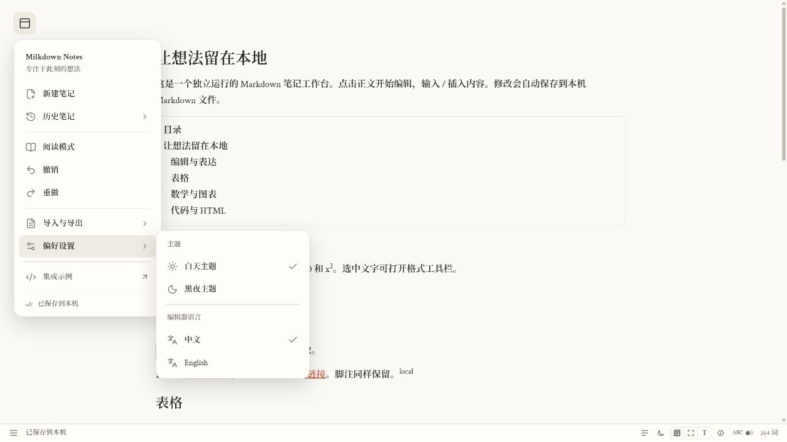</td>
<td>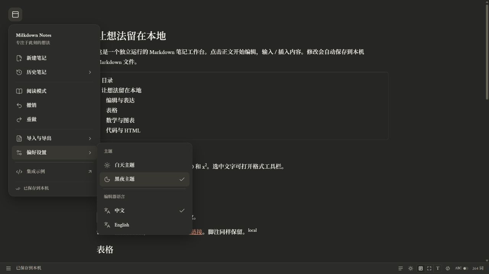</td>
</tr>
</table>

<details>
<summary><strong>Settings, AI diff review, and a 240 px sidebar</strong></summary>

<table>
<tr><th>Settings</th><th>AI diff review</th><th>240 px sidebar</th></tr>
<tr>
<td>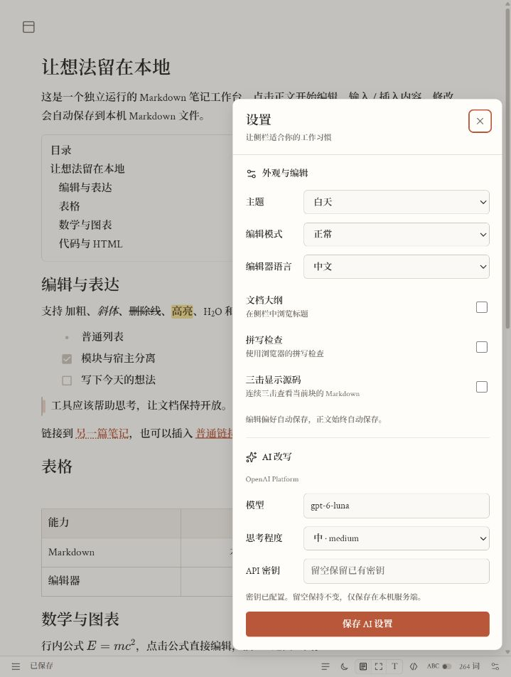</td>
<td>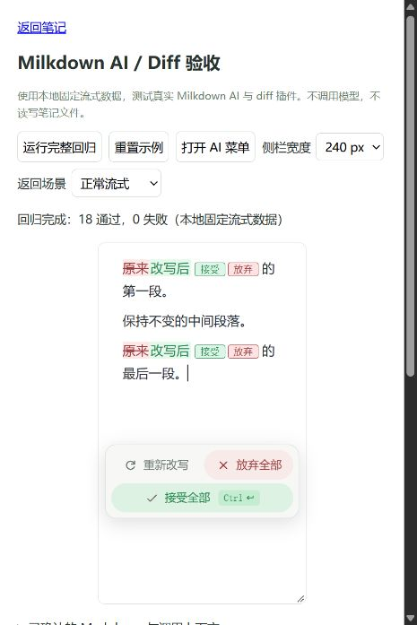</td>
<td>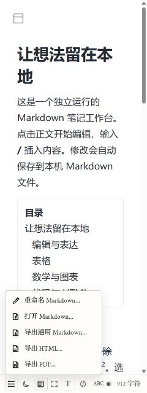</td>
</tr>
</table>

</details>

The sidebar is checked at **240, 300, 390, 650, and 900 px container widths**. The footer stays 30 px tall; narrow containers keep control sizes and allow the action strip to scroll horizontally. Width adaptation is tested separately from mobile-device support.

## Markdown syntax gallery

### Everyday Markdown

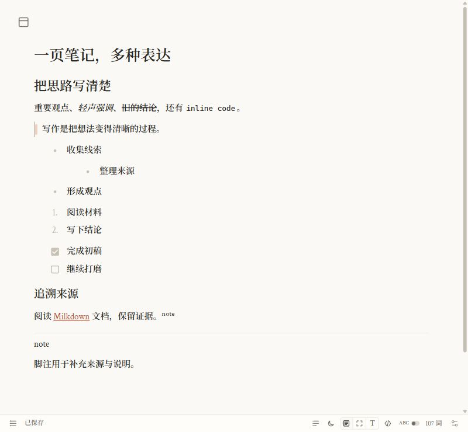

### Tables and highlighted code

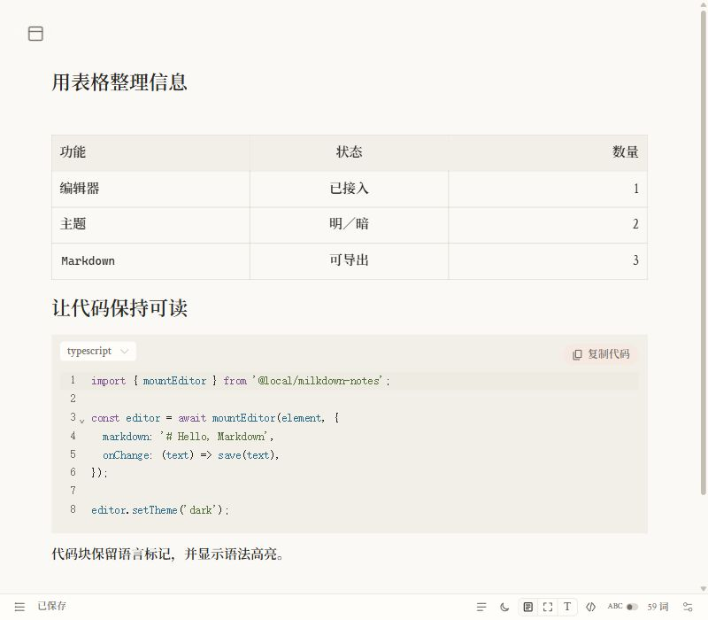

### Math and Mermaid diagrams

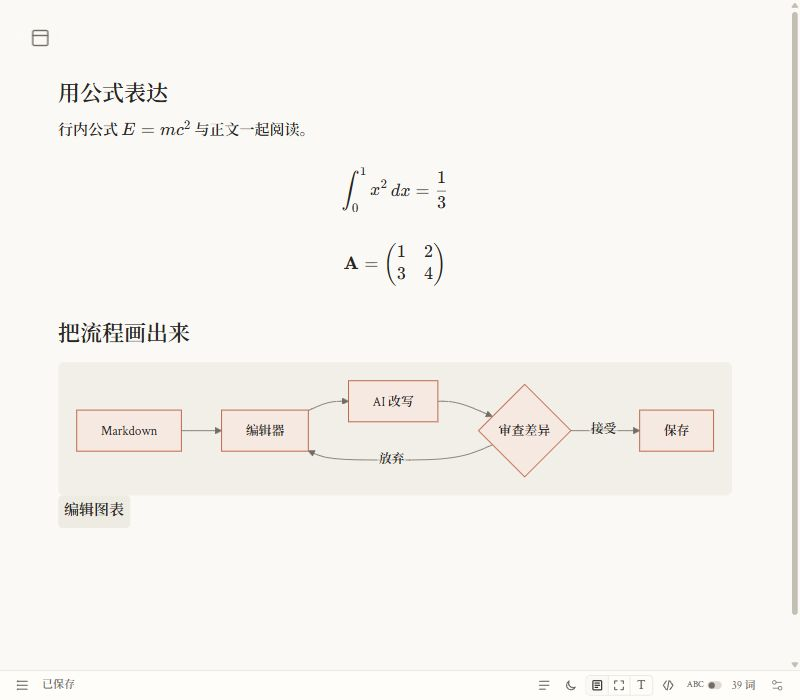

### Project-specific syntax · Light

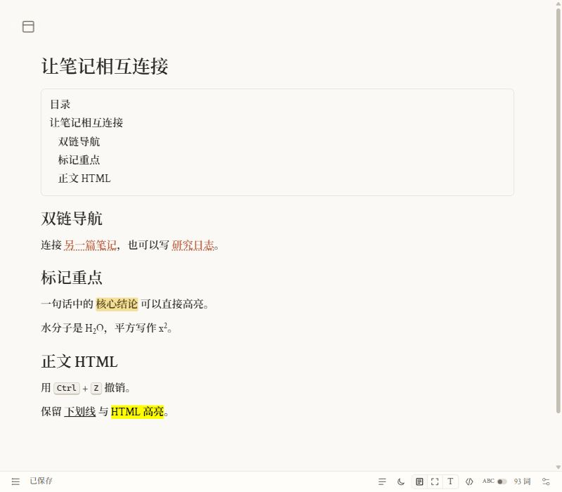

### Project-specific syntax · Dark

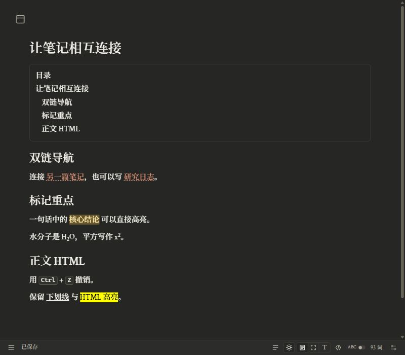

### Images, captions, and sizing

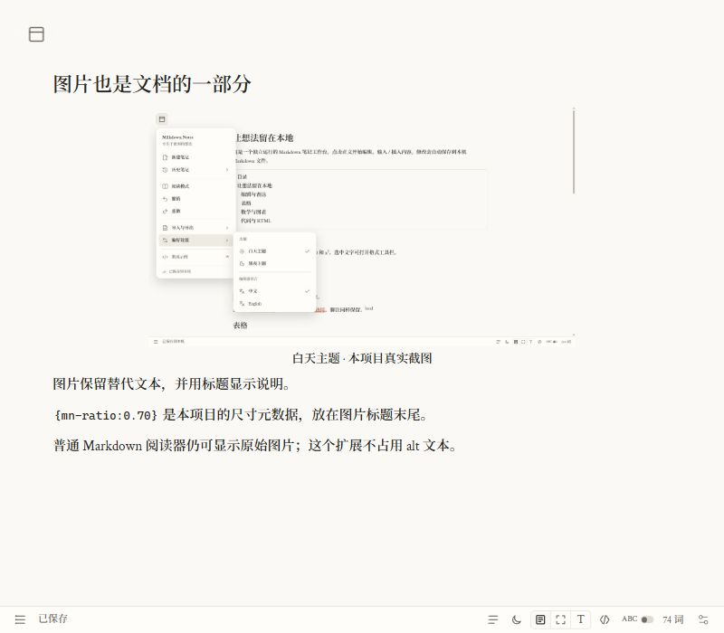

## What works today

| Capability                   | Implementation                                                                                                                    |
| ---------------------------- | --------------------------------------------------------------------------------------------------------------------------------- |
| **Immersive sidebar**        | Top-left expandable menu, saved notes, reading mode, undo/redo, import/export, and a slim footer                                  |
| **Rich Markdown**            | CommonMark/GFM, task lists, tables, footnotes, images, code highlighting, KaTeX, and Mermaid                                      |
| **Knowledge-tool content**   | `[[wiki links]]`, `[TOC]`, `==highlight==`, subscript, superscript, host references and backlinks                                 |
| **Streaming AI**             | Selection or whole-document rewrites, cancellation, retry, partial-output review, accept/reject, and undo                         |
| **External document review** | Host-supplied before/after Markdown, candidate decisions, table annotations, versioned image assets, and read-only history        |
| **File handling**            | Host file adapter, local Markdown autosave, stable note IDs, rename, image upload, and import                                     |
| **Export**                   | Markdown, self-contained HTML with local assets, and browser PDF printing or a host PDF exporter                                  |
| **Preferences**              | Light/dark themes, normal/focus/typewriter modes, outline, spelling, triple-click block source, and Chinese/English editor labels |
| **Reusable modules**         | Framework-independent editor API, complete sidebar API, multi-instance isolation, and typed lifecycle hooks                       |

## Why this project

Use the complete sidebar when your application needs menus, files, and editing together. Use the editor alone when your host already owns navigation. Use the review interface when another agent or service produces a proposed document.

The editor does not own your filesystem or model credentials. `NoteFiles` and `AIProvider` keep those decisions in the host. React is used internally for the footer; a React host is not required.

## Quick start

Requires **Node.js 22.12+** and npm. Local development has been validated on Windows; a full cross-platform/browser matrix is not yet complete.

```sh
git clone https://github.com/Hemistic/milkdown-notes.git
cd milkdown-notes
npm ci
npm run build
npm start
```

Open **http://127.0.0.1:43150/**. Basic editing works without an AI account.

| Local route             | Purpose                                                           |
| ----------------------- | ----------------------------------------------------------------- |
| `/`                     | Local notes application                                           |
| `/example/`             | Independent editor and read-only renderer                         |
| `/example/syntax.html`  | Five Markdown source/rendering samples with light/dark themes     |
| `/example/sidebar.html` | Two embedded sidebars, memory-backed files, and regression checks |
| `/example/ai.html`      | Editor and AI/diff checks using fixed streaming data              |
| `/example/live-ai.html` | Optional real-model checks; running them consumes model quota     |

`npm run dev` builds and starts the server; it does not provide hot reload. Rebuild and refresh after changing source.

Notes live in `.data/notes/*.md`, name metadata in `.md.json` sidecars, and uploaded images in `.data/assets/`. These files and `.env.local` are excluded from Git. Back up both notes and assets.

To choose a different data directory or port in PowerShell:

```powershell
$env:NOTES_DATA_DIR = 'D:\MyNotes'
$env:PORT = '43151'
npm start
```

The server listens only on `127.0.0.1`. It is a local web application that needs a running Node process, not an installer or a cloud service.

## Integrate with your software

Build this repository, then install both local packages in your host project:

```sh
npm install /path/to/milkdown-notes/packages/editor /path/to/milkdown-notes/packages/sidebar
```

```ts
import { mountSidebar, type NoteFiles } from '@local/milkdown-sidebar';
import '@local/milkdown-sidebar/style.css';

const files: NoteFiles = {
  list: () => host.notes.list(),
  read: (id) => host.notes.read(id),
  write: (id, markdown) => host.notes.write(id, markdown),
  rename: (id, title) => host.notes.rename(id, title),
  uploadImage: (file) => host.images.upload(file),
  resolveAsset: (source) => host.images.url(source),
};

const sidebar = await mountSidebar(element, {
  files,
  preferences: { theme: 'light' },
  aiProvider: (context, signal) => host.ai.stream(context, signal),
  onPreferencesChange: (value) => host.preferences.save(value),
});

await sidebar.open('note-id');
await sidebar.flush();
// When the host unmounts this sidebar:
await sidebar.destroy();
```

`host` is your implementation, not a global supplied by the package. Use HTTP, Electron IPC, Tauri commands, or another host service. The container must be empty and have an explicit height. `write` creates or overwrites a note; renaming preserves its ID. AI and image upload are optional.

For the editor alone:

```ts
import { mountEditor } from '@local/milkdown-notes';
import '@local/milkdown-notes/style.css';

const editor = await mountEditor(element, {
  markdown: '# Hello\n\nStart writing.',
  locale: 'en',
  theme: 'light',
  onChange: (markdown) => host.notes.save(markdown),
});
```

Use `renderMarkdown()` for the same rich renderer in read-only mode. Without a bundler, serve the **whole** `dist` directories, including chunks, fonts, styles, and licenses. See the [sidebar contract](docs/sidebar-integration.md), [editor API](docs/integration.md), and [runnable examples](examples/vanilla).

## AI and document review

In the local app, open **Settings** at the right of the footer. Enter the model, reasoning effort, and API key, then save. Configuration takes effect on the next request. Keys stay in the local Node service; the browser receives only configuration metadata. Available models and parameters depend on your provider account.

A host can supply its own provider:

```ts
type AIProvider = (
  context: { document: string; selection: string; instruction: string },
  signal: AbortSignal,
) => AsyncIterable<string>;
```

Yield incremental Markdown chunks, honor the abort signal, and throw on failure. The UI handles review before saving confirmed changes. The public controller exposes `run`, `abort`, `accept`, `reject`, and `getState` on `sidebar.editor.ai`. OpenAI and Anthropic provider factories are also available through the editor's `/providers` entry.

For proposals generated elsewhere, `mountEditor` accepts `review`, `onReviewChoice`, and `onReviewResult`. The host supplies original/candidate documents and decides how to persist the reviewed result. Selection and scroll state can be transferred with `getViewState()` / `restoreViewState()`; undo history is not serialized. See [external review](docs/external-review.md).

## Development and validation

```sh
npm run typecheck
npm test
npm run build
npm run format:check
```

- **23 Node tests:** storage, HTTP adapters, AI streaming/cancellation/truncation, configuration, statistics, and upstream compatibility.
- **34 editor + 17 sidebar browser checks:** run from the two local regression pages above. They use fixed streams and do not call paid models.
- **Performance checks:** a 200-paragraph document can switch themes ten times without rereading Markdown; a save reads it once; normal mode performs no focus-layout measurement on selection changes. These are operation-count checks, not an overall speed benchmark.
- **Real-model validation:** separately documented in [live AI verification](docs/live-ai-verification.md), including timeouts and retests. External review integration is recorded in [external review](docs/external-review.md).

```text
milkdown-notes/
├── packages/editor/   Rich editor, Markdown schema, AI and document review
├── packages/sidebar/  Menus, footer, preferences, file adapter and export
├── apps/local/        Local Node server and notes application
├── examples/          Browser integration and regression pages
├── tests/             Node regression checks
├── scripts/           Build, pinned Milkdown adapters and license notices
└── docs/              Integration, architecture, provenance and evidence
```

## Current boundaries

- Markdown is normalized on serialization; it is not a byte-for-byte source editor. Image sizing uses a documented title suffix.
- Local persistence is designed for one active editing session. Cloud sync, collaboration, and concurrent-write conflict resolution belong to the host.
- Browser DOM is required. There is no server-side string renderer or native Electron/Tauri packaging included.
- PDF export uses browser printing unless a host supplies a native exporter. Saving a PDF from the embedded browser has not been fully validated.
- Full browser/platform coverage and large-document latency benchmarks remain future work. Supporting technical documents are mostly in Chinese.

## Sources and license status

Extracted from the user's Artinfact 0.13.41 notes implementation, with the snapshot footer adapted separately. Source manifests, upstream adaptations, fonts, and third-party notices are preserved in [attribution](docs/attribution.md), [upstream adapters](docs/upstream-adapters.md), and [licenses](licenses/).

This is a **public source repository**, not a grant of a new project-wide open-source license. Package metadata remains `UNLICENSED` and `private: true` (preventing accidental npm publication). Third-party components retain their own terms. No new MIT/AGPL license is asserted for the extracted application code.

The README presentation follows the companion [ChatGPT Claude Sidebar](https://github.com/Hemistic/chatgpt-claude-sidebar): real interface captures first, followed by capabilities, setup, and host integration. The products are separate projects.
