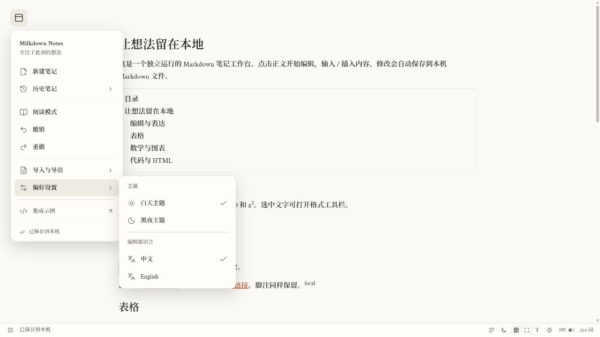
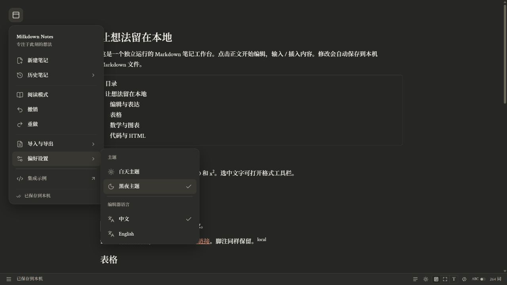
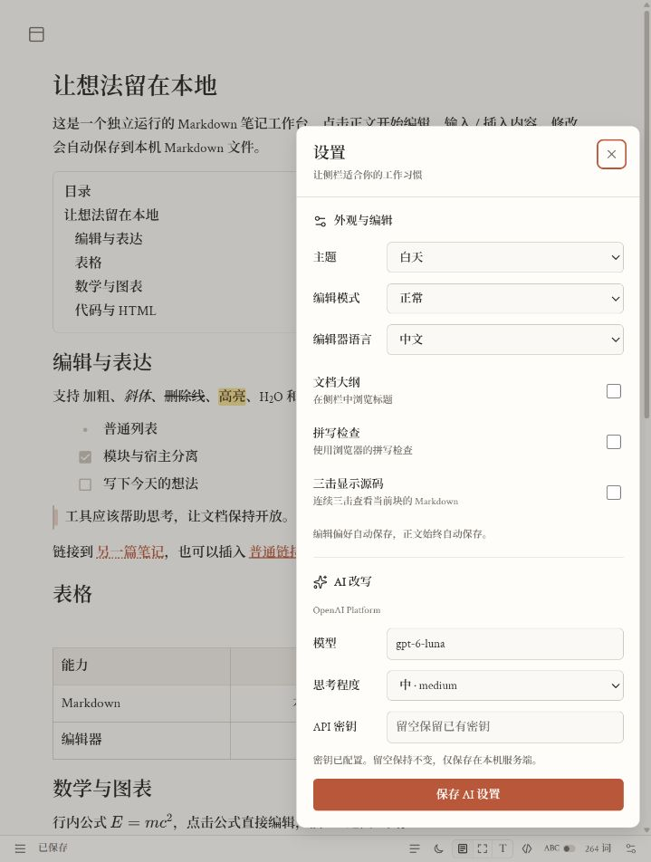
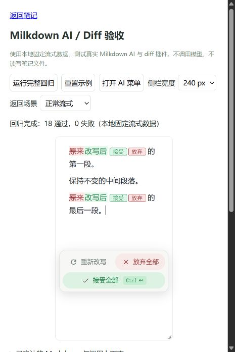
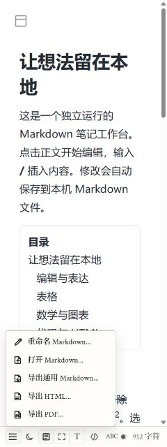

<div align="center">

# Milkdown Notes

[English](README.md) · **简体中文**

**面向 AI 软件开发者的可复用 Markdown 编辑基础设施**

把编辑器、侧栏和差异审查接入你自己的软件。

TypeScript · Milkdown / ProseMirror · 本地 Markdown 文件 · 开发预览

[界面预览](#界面预览) · [功能清单](#当前已经有什么) · [快速开始](#快速开始) · [宿主接入](#接入自己的软件) · [AI 与审查](#ai-与文档审查) · [开发验证](#开发与验证)

</div>

阅读器、研究工具和 AI 工作台，经常需要重复建设同一套能力：富文本 Markdown 编辑、文件操作、流式改写，以及让用户明确接受或放弃修改的审查界面。

**Milkdown Notes 把这些能力整理成可嵌入侧栏与独立编辑器。** 仓库附带的本地笔记应用也使用同一套公开接口。你的软件负责存储、导航和模型连接，模块提供编辑体验。

> 开发预览。浏览器模块和本地 Node 应用已实现；软件包从源码构建，尚未发布到 npm。这是独立项目，不属于 Milkdown 官方产品。

## 界面预览

以下是本项目 2026 年 10 月本机验收的真实截图，正文为演示内容，界面为中文。主题截图早于集中设置按钮的加入，设置截图展示了该功能；diff 截图使用固定测试流，并非实时模型调用。

<table>
<tr><th width="50%">白天主题</th><th width="50%">黑夜主题</th></tr>
<tr>
<td></td>
<td></td>
</tr>
</table>

<details>
<summary><strong>查看设置、AI 差异审查与 240 px 侧栏</strong></summary>

<table>
<tr><th>设置</th><th>AI 差异审查</th><th>240 px 侧栏</th></tr>
<tr>
<td></td>
<td></td>
<td></td>
</tr>
</table>

</details>

侧栏已检查 **240、300、390、650、900 px 容器宽度**。底栏保持 30 px 高，窄栏保留按钮尺寸，操作区可以横向滚动访问。容器宽度适配不等同于已完成移动设备验收。

## 当前已经有什么

| 能力                | 当前实现                                                                     |
| ------------------- | ---------------------------------------------------------------------------- |
| **沉浸式侧栏**      | 左上角展开菜单、历史笔记、阅读模式、撤销重做、导入导出和窄底栏               |
| **富文本 Markdown** | CommonMark/GFM、任务列表、表格、脚注、图片、代码高亮、KaTeX 和 Mermaid       |
| **知识工具内容**    | `[[双链]]`、`[TOC]`、`==高亮==`、上下标、宿主引用与反向链接                  |
| **流式 AI**         | 选区或全文改写、取消、重试、部分输出审查、接受／放弃及撤销                   |
| **外部文档审查**    | 宿主传入修改前后 Markdown、候选选择、表格批注、版本化图片资源与只读历史      |
| **文件处理**        | 宿主文件适配器、本地 Markdown 自动保存、稳定笔记 ID、重命名、图片上传和导入  |
| **导出**            | Markdown、内嵌本机资源的 HTML、浏览器 PDF 打印或宿主 PDF 导出器              |
| **偏好设置**        | 白天／黑夜、正常／专注／打字机模式、大纲、拼写、三击块源码及中英文编辑器标签 |
| **可复用模块**      | 无框架绑定的编辑器 API、完整侧栏 API、多实例隔离和带类型的生命周期接口       |

## 为什么做这个项目

软件需要菜单、文件管理和编辑一体化时，可以接入完整侧栏；宿主已有导航时，可以只接编辑器；其他 Agent 或服务生成修改建议时，可以接入文档审查接口。

编辑器不管理宿主的文件系统或模型凭证。`NoteFiles` 与 `AIProvider` 将这些职责留给宿主。React 仅用于内部底栏，使用方不必采用 React。

## 快速开始

需要 **Node.js 22.12+** 和 npm。本机开发在 Windows 验证，完整跨平台与浏览器矩阵尚未完成。

```sh
git clone https://github.com/Hemistic/milkdown-notes.git
cd milkdown-notes
npm ci
npm run build
npm start
```

打开 **http://127.0.0.1:43150/**。基础编辑不需要 AI 账户。

| 本地路径                | 用途                                     |
| ----------------------- | ---------------------------------------- |
| `/`                     | 本地笔记应用                             |
| `/example/`             | 独立编辑器和只读渲染示例                 |
| `/example/sidebar.html` | 双侧栏、内存文件接口和回归检查           |
| `/example/ai.html`      | 固定流式数据的编辑器与 AI/diff 验收      |
| `/example/live-ai.html` | 可选真实模型验收，点击运行会消耗模型额度 |

`npm run dev` 会构建并启动服务，当前没有热更新；修改源码后重新构建、刷新页面。

笔记保存在 `.data/notes/*.md`，名称元数据保存在 `.md.json` 附属文件，图片保存在 `.data/assets/`。这些数据及 `.env.local` 均被 Git 忽略。备份时一起复制笔记和图片。

PowerShell 中可修改数据目录与端口：

```powershell
$env:NOTES_DATA_DIR = 'D:\MyNotes'
$env:PORT = '43151'
npm start
```

服务只监听 `127.0.0.1`。这是需要 Node 进程运行的本地网页应用，不是安装包或云服务。

## 接入自己的软件

先构建本仓库，再在宿主项目中安装两个本地包：

```sh
npm install /path/to/milkdown-notes/packages/editor /path/to/milkdown-notes/packages/sidebar
```

```ts
import { mountSidebar, type NoteFiles } from '@local/milkdown-sidebar';
import '@local/milkdown-sidebar/style.css';

const files: NoteFiles = {
  list: () => host.notes.list(),
  read: (id) => host.notes.read(id),
  write: (id, markdown) => host.notes.write(id, markdown),
  rename: (id, title) => host.notes.rename(id, title),
  uploadImage: (file) => host.images.upload(file),
  resolveAsset: (source) => host.images.url(source),
};

const sidebar = await mountSidebar(element, {
  files,
  preferences: { theme: 'light' },
  aiProvider: (context, signal) => host.ai.stream(context, signal),
  onPreferencesChange: (value) => host.preferences.save(value),
});

await sidebar.open('note-id');
await sidebar.flush();
// 宿主卸载此侧栏时：
await sidebar.destroy();
```

`host` 是你自己实现的接口，不是本包提供的全局对象。可以通过 HTTP、Electron IPC、Tauri commands 或其他宿主服务接入。容器必须为空并有明确高度；`write` 同时支持新建和覆盖，重命名保持 ID 不变。AI 与图片上传是可选能力。

只接入编辑器：

```ts
import { mountEditor } from '@local/milkdown-notes';
import '@local/milkdown-notes/style.css';

const editor = await mountEditor(element, {
  markdown: '# 你好\n\n开始写作。',
  locale: 'zh-CN',
  theme: 'light',
  onChange: (markdown) => host.notes.save(markdown),
});
```

`renderMarkdown()` 使用同一套富文档渲染器提供只读模式。没有打包器时，必须提供**整个** `dist` 目录，保留 chunks、字体、样式和许可证。详见 [侧栏契约](docs/sidebar-integration.md)、[编辑器 API](docs/integration.md) 和 [可运行示例](examples/vanilla)。

## AI 与文档审查

本地应用中，点击底栏右侧「设置」，填写模型、思考程度和密钥并保存，下一次请求即生效。密钥留在本机 Node 服务端，浏览器只获取配置状态。可用模型和参数由对应服务及账户决定。

宿主可以实现自己的 provider：

```ts
type AIProvider = (
  context: { document: string; selection: string; instruction: string },
  signal: AbortSignal,
) => AsyncIterable<string>;
```

按顺序产出增量 Markdown 文本、响应取消信号，出错时抛出异常。界面先审查，再保存已确认修改。`sidebar.editor.ai` 提供 `run`、`abort`、`accept`、`reject` 和 `getState`；编辑器 `/providers` 入口也提供 OpenAI、Anthropic provider 工厂。

对其他地方生成的建议，`mountEditor` 接受 `review`、`onReviewChoice` 和 `onReviewResult`。宿主提供原稿／候选稿，并决定怎样保存审查结果。`getViewState()` / `restoreViewState()` 可传递选区与滚动状态，不包含序列化撤销历史。详见 [外部文档审查](docs/external-review.md)。

## 开发与验证

```sh
npm run typecheck
npm test
npm run build
npm run format:check
```

- **23 项 Node 测试**：存储、HTTP 适配、AI 流式／取消／截断、配置、统计和上游兼容。
- **34 项编辑器 + 17 项侧栏浏览器检查**：从上面的回归页面运行，使用固定流式数据，不调用付费模型。
- **性能检查**：200 段长文切换主题十次不重新读取 Markdown；保存只读取一次；普通模式的选区变化不测量焦点布局。这些是操作次数检查，不是整体速度基准。
- **真实模型验收**：单独记录在 [真实 AI 验收](docs/live-ai-verification.md)，保留超时和重测情况；外部审查接入记录见 [外部文档审查](docs/external-review.md)。

```text
milkdown-notes/
├── packages/editor/   富文本编辑器、Markdown schema、AI 和文档审查
├── packages/sidebar/  菜单、底栏、偏好、文件适配和导出
├── apps/local/        本地 Node 服务与笔记应用
├── examples/          浏览器接入示例与回归页面
├── tests/             Node 回归检查
├── scripts/           构建、固定版本 Milkdown 适配与许可清单
└── docs/              接入、架构、来源与验收证据
```

## 当前边界

- Markdown 序列化会规范化格式，不保证逐字节往返；图片尺寸使用已记录的标题后缀约定。
- 本地持久化面向一个活动编辑会话。云同步、协作与并发写入冲突由宿主处理。
- 模块需要浏览器 DOM，没有服务端字符串渲染器，也没有附带 Electron/Tauri 原生安装包。
- PDF 默认使用浏览器打印，宿主也可接原生导出；内置浏览器中保存 PDF 文件尚未完整验证。
- 完整浏览器／平台矩阵和大文档延迟基准仍待完善。配套技术文档目前主要为中文。

## 来源与许可状态

本项目从用户的 Artinfact 0.13.41 笔记实现提取，并单独适配快照底栏。原始文件清单、上游改动、字体与第三方声明保存在 [来源说明](docs/attribution.md)、[上游适配](docs/upstream-adapters.md) 和 [licenses](licenses/) 中。

这是**公开源码仓库**，没有新增整个项目的开源授权。包元数据继续使用 `UNLICENSED` 和 `private: true`，后者用于避免意外发布 npm 包；第三方组件保留各自许可。没有擅自为提取的应用代码指定 MIT 或 AGPL。

README 的展示结构参考配套项目 [ChatGPT Claude Sidebar](https://github.com/Hemistic/chatgpt-claude-sidebar)：先展示真实界面，再说明功能、运行与宿主接入。两者是独立项目。
